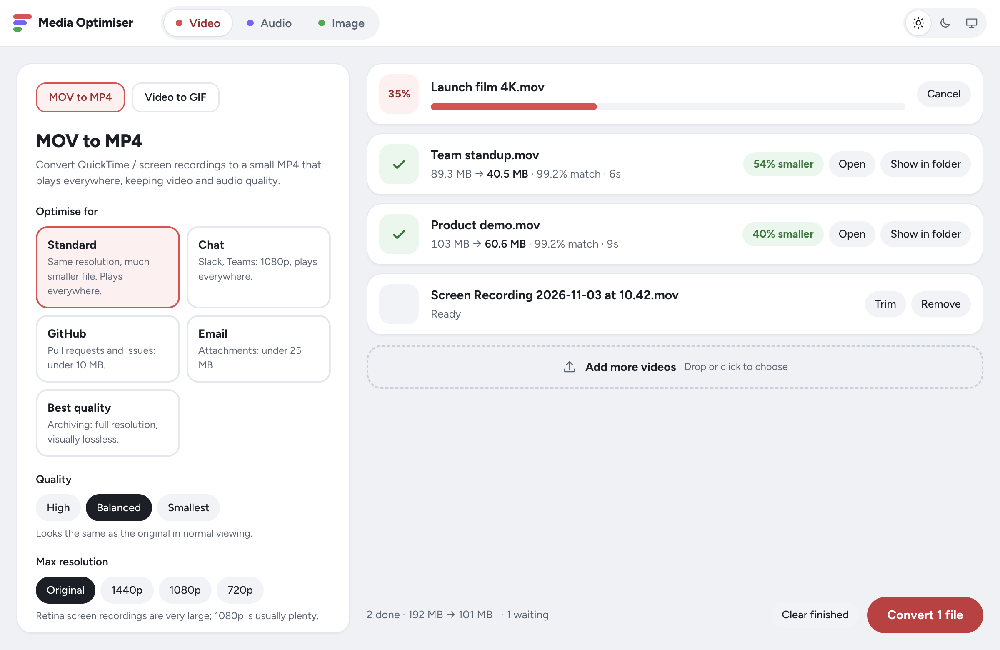
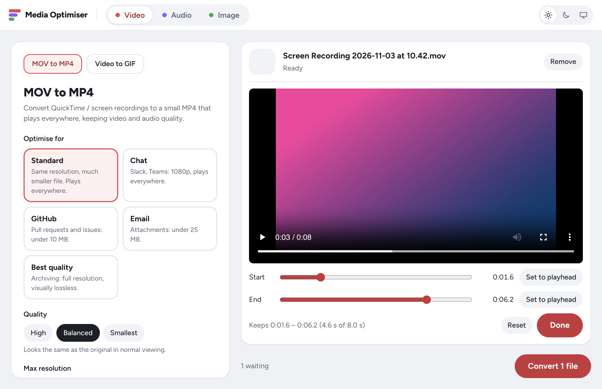
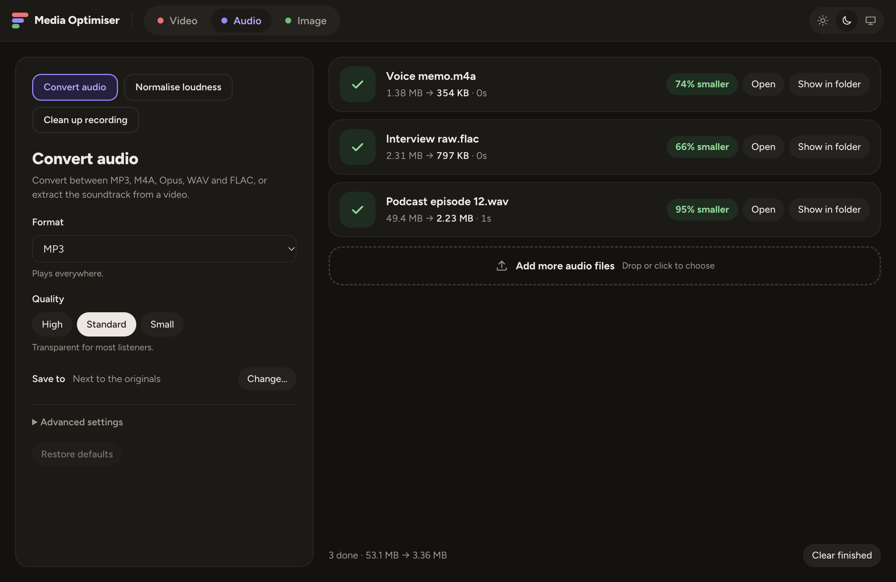
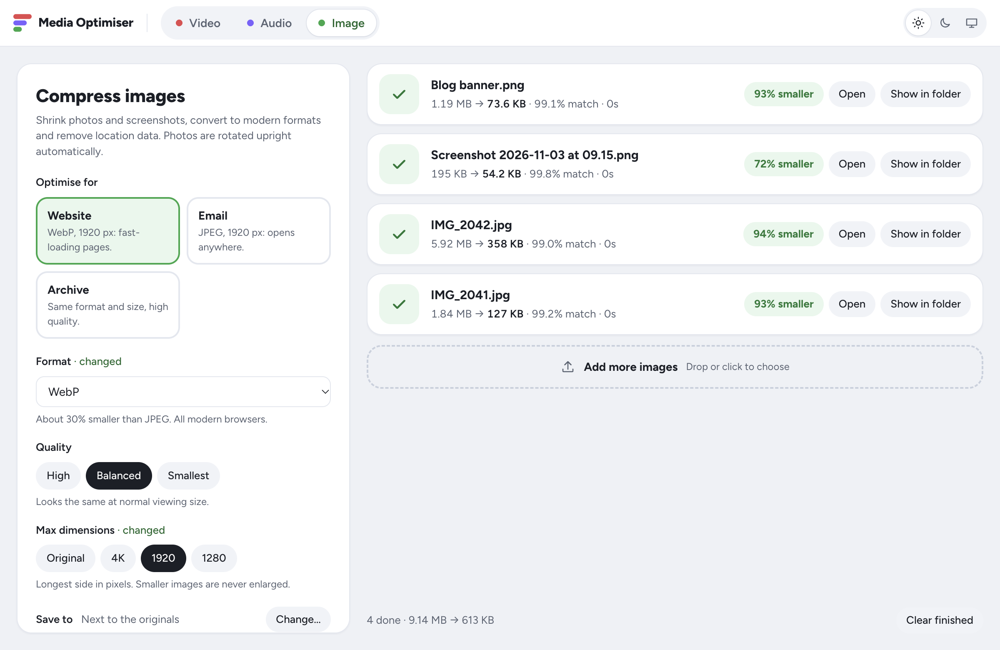

<div align="center">


# Media Optimiser

**Smaller files. Same quality.**

Shrink and convert videos, audio and images on your own computer.<br>
Free, open source, and works on macOS, Windows and Linux.

[](https://github.com/echoabhishek/media-optimiser/actions/workflows/ci.yml)
[](LICENSE)


[Download](https://github.com/echoabhishek/media-optimiser/releases) · [Features](#features) · [Command line](docs/cli.md) · [How it works](docs/how-it-works.md) · [Contributing](CONTRIBUTING.md)

</div>

<picture>
  <source media="(prefers-color-scheme: dark)" srcset="docs/screenshots/video-dark.png">
  
</picture>

## Why

Screen recordings, phone videos and photos are often much bigger than they need to be.
Media Optimiser makes them small enough to share in Slack, email or a pull request,
**without visible quality loss**. It also tells you how close the result is to the original.

- **Simple by default.** Pick a preset like _Email_ or _GitHub_, drop files, press Convert. Advanced settings stay out of the way until you need them.
- **Private.** Everything runs on your computer. No uploads, no accounts, no tracking.
- **Nothing to install.** FFmpeg and libvips come built in.
- **Safe.** Originals are never overwritten, and a cancelled job never leaves a broken file behind.

## Features

### Video

- **MOV to MP4:** H.264 (plays everywhere) or H.265 (smaller), tuned for screen recordings or camera footage.
- **Presets:** Standard, Chat, GitHub (under 10 MB), Email (under 25 MB) and Best quality.
- **Size limit:** set a maximum size, and the app re-encodes harder only when it has to.
- **Trim** each file with a preview player before converting.
- **Video to GIF** with an optimised colour palette, for docs and pull requests.
- Removes location and device data by default.



### Audio

- **Convert** between MP3, M4A (AAC), Opus, WAV and FLAC, or pull the soundtrack out of a video.
- **Normalise loudness** to the levels streaming platforms and podcasts expect (−14, −16 or −23 LUFS).
- **Clean up recordings:** reduce background noise and hum, and trim silence from the start and end.



### Images

- **Compress and convert** to JPEG, WebP, AVIF or PNG, with presets for websites, email and archiving.
- Photos are turned upright automatically and never enlarged.
- Location and camera data are removed by default; colour profiles are kept.
- A file is never made bigger: if re-encoding wouldn't help, the original is kept.
- iPhone **HEIC** photos work on macOS.



### Everyday conveniences

- **Quality score:** every result shows how closely it matches the original ("99.2% match").
- **Drag out** finished files straight into Slack, email or Finder.
- **Watch a folder:** new files (for example, screen recordings on your Desktop) convert automatically.
- **Open With:** open files from Finder, the Dock or the command line in the right tool.
- **Move originals to the Trash** after converting (optional).
- **Light and dark themes**, or follow your system.
- A **command-line interface** for scripts and batch jobs.

## Download

Get the latest version from the [Releases page](https://github.com/echoabhishek/media-optimiser/releases):

| Platform                        | File                                                       |
| ------------------------------- | ---------------------------------------------------------- |
| macOS (Apple Silicon and Intel) | `.zip`: unzip and drag **Media Optimiser** to Applications |
| Windows                         | `Setup.exe`                                                |
| Linux                           | `.deb` (Debian, Ubuntu) or `.rpm` (Fedora, openSUSE)       |

> [!NOTE]
> Until code signing is set up, macOS and Windows warn the first time you open the app.
> On macOS, right-click the app and choose **Open**. On Windows, choose **More info → Run anyway**.

## Command line

The app doubles as a command-line tool. Each tool is a command, and its flags come from the same settings you see in the app.

```console
$ media-optimiser mov-to-mp4 "Team standup.mov" "Product demo.mov" --preset chat --out ~/Desktop
✓ [1/2] Team standup.mov  89.3 MB → 40.5 MB (54% smaller, 99.2% match)
✓ [2/2] Product demo.mov  103 MB → 60.6 MB (40% smaller, 99.2% match)
```

See the [command-line guide](docs/cli.md) for every tool, `--json` output and how to put `media-optimiser` on your `PATH`.

## Build from source

You need [Node.js](https://nodejs.org) 22 or later.

```sh
git clone https://github.com/echoabhishek/media-optimiser.git
cd media-optimiser
npm install   # also downloads FFmpeg for your platform
npm start     # run the app with hot reload
```

The [development guide](docs/development.md) covers tests, project structure, adding a tool and building installers.

## Documentation

| Guide                                | What's in it                                                             |
| ------------------------------------ | ------------------------------------------------------------------------ |
| [Command line](docs/cli.md)          | Tools, flags, presets, JSON output, exit codes                           |
| [How it works](docs/how-it-works.md) | Encoding choices, quality score, file safety, image and audio processing |
| [Development](docs/development.md)   | Setup, architecture, adding a tool, testing, releasing and signing       |
| [Contributing](CONTRIBUTING.md)      | How to report bugs and send pull requests                                |

## Contributing

Bug reports, ideas and pull requests are welcome. Please read [CONTRIBUTING.md](CONTRIBUTING.md) first.
If a conversion fails, the app's **Copy error details** button gives you everything a bug report needs.

## Licence

Media Optimiser is released under the [MIT licence](LICENSE).

It bundles [FFmpeg](https://ffmpeg.org) (GPL build), [libvips](https://www.libvips.org) via [sharp](https://sharp.pixelplumbing.com), and the [Figtree](https://github.com/erikdkennedy/figtree) font.
See [THIRD_PARTY_NOTICES.md](THIRD_PARTY_NOTICES.md) for their licences.
